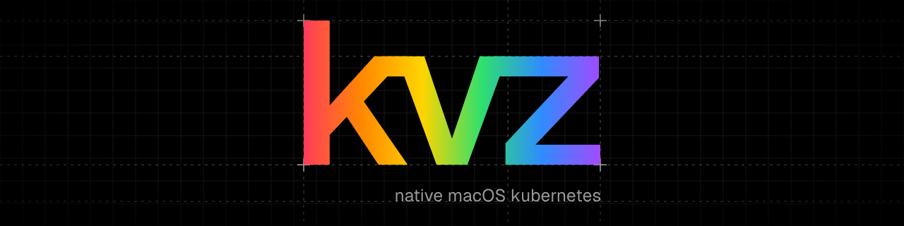

<p align="center">
  <picture>
    <source media="(prefers-color-scheme: light)" srcset="docs/assets/brand-v1/readme-banner-light-1280x320.svg">
    
  </picture>
</p>

# kvz: native-macOS Kubernetes

A k3s-style, single-binary Kubernetes distribution that runs **natively on
macOS**. The control plane has no Linux VM: etcd, kube-apiserver,
controller-manager and scheduler run in one darwin process. Pods run on three
native runtimes:

| `runtimeClassName` | What a pod is | Built on |
|---|---|---|
| `linux` (default) | **its own cold-booted Linux microVM**, ready in ~90–100 ms | kvz's microVM monitor on Virtualization.framework, kvz kernel (8.5 MB), Go PID 1, virtiofs + tmpfs overlay |
| `macos` | a full macOS VM (container 0), exec over SSH | Virtualization.framework; APFS `clonefile` disk (50 GB in under 1 ms) |
| `darwin` | native macOS processes | fork/exec, per-pod dir, process-group kill |
| `apple` | a container through Apple's `container` daemon (v1 runtime) | Apple Containerization |

Pod networking is kvz's own: an in-process L2 switch with gVisor netstack
gateway/DNS, ClusterIP Services (DNAT in the switch), cluster DNS, and
LoadBalancer/NodePort on the host. It uses no vmnet interfaces.
Extra Macs join as nodes with a k3s-style token.

## Quickstart

```sh
make build                       # builds + ad-hoc signs bin/kvz (needs the virtualization entitlement)
./bin/kvz server                 # prints KUBECONFIG and a join command
export KUBECONFIG=~/.kvz/kubeconfig.yaml
kubectl run web --image=nginx:alpine                       # Linux micro-VM
kubectl apply -f - <<'EOF'
apiVersion: v1
kind: Pod
metadata: {name: mac}
spec:
  runtimeClassName: macos
  containers: [{name: vm, image: ghcr.io/cirruslabs/macos-tahoe-base:latest}]
EOF
kubectl exec mac -- sw_vers                                # runs inside the macOS guest

# on another Mac
kvz agent --server https://<server-ip>:6443 --token K10…::…
```

Requirements: Apple Silicon, macOS 26+. The `linux` runtime needs the kvz
kernel (`kernel/build.sh` → `~/.kvz/kernel/Image`; it falls back to Apple's
`container` kernel if present). The `macos` runtime needs a tart-format VM
bundle; OCI refs are pulled with `tart`.

## Headline numbers (M4 Mac mini, median of 3; see [docs/BENCHMARKS.md](docs/BENCHMARKS.md))

| | kvz | k3s in Lima | Apple `container cluster` |
|---|---|---|---|
| restart → API ready | **1.7 s** | 9.3 s | 58 s (create) |
| idle CPU / memory | **1.6 % / 257 MB** | 20 % / 3.2 GB | 26 % / 2.5 GB |
| 1 nginx pod → Ready | **99 ms** | 421 ms | 859 ms |
| 20 nginx pods → all Ready | **0.44 s** (Studio 0.23 s) | 1.30 s | 0.88 s |
| 50 nginx pods → all Ready | **1.5 s** (Studio 0.62 s) | 4.5 s | 4.2 s |
| memory with 20 pods | **1.6 GB** | 3.8 GB | 3.0 GB |
| delete 20 pods | **0.11 s** | 0.81 s | 1.18 s |
| API creates/s | **9.6k** | 3.2k | 8.0k |
| pod-to-pod TCP | 49–52 Gbps | 84 Gbps | 86 Gbps |
| native macOS process / macOS VM pods | **yes** | no | no |

Every kvz Linux pod is a fresh VM: no pools, snapshots or pre-started pods.
The one loss, pod-to-pod bandwidth, is the cost of that isolation.

## Docs
* [docs/REPORT.md](docs/REPORT.md): the overnight optimization report (12 s → 0.25 s and everything else)
* [docs/ARCHITECTURE.md](docs/ARCHITECTURE.md): how it works and what was needed to embed k8s on darwin
* [docs/BENCHMARKS.md](docs/BENCHMARKS.md): full methodology and results across 4 Macs
* `results/`: raw JSONL and the generated `SUMMARY.md`

## Status
Prototype. Not implemented yet: cross-node pod networking (each node has its
own pod network), NetworkPolicy, attach stdin, stats summary.
