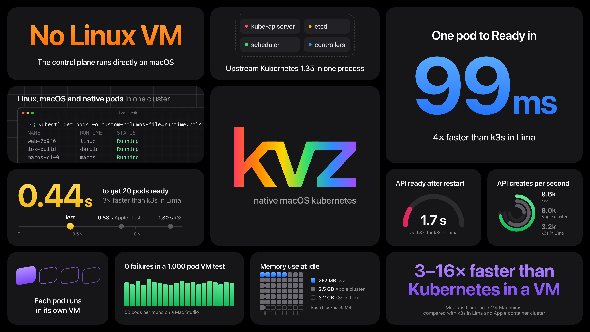
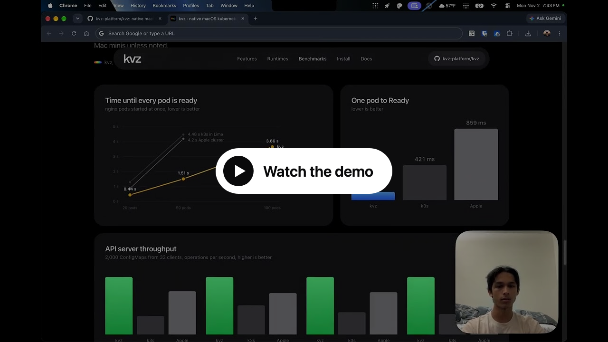
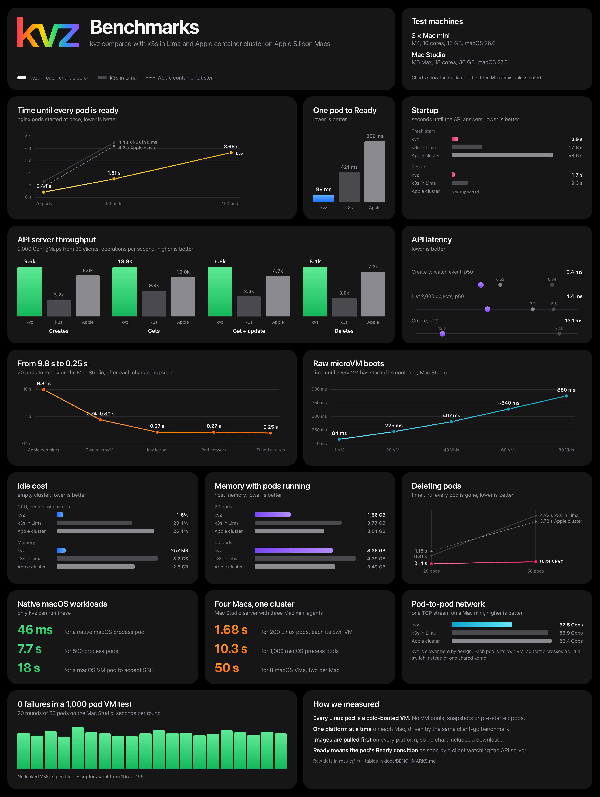

<p align="center">
  
</p>

# kvz

**Kubernetes that runs natively on your Mac.** kvz is a single binary, in the
spirit of k3s. The whole control plane (etcd, the API server, the scheduler and
the controllers) runs as one ordinary macOS process, with no Linux VM
underneath. Your pods run as:

- **Linux pods.** Each one is its own lightweight VM, ready in about 100 ms.
- **macOS pods.** A full macOS virtual machine you can `kubectl exec` into.
- **Native pods.** Plain macOS processes, for Xcode builds, code signing or
  anything that needs the real Mac.

You use it with the same `kubectl` and YAML you already know.

## Demo

<a href="https://youtu.be/GUZCElkfb1U">
  
</a>

## Quick start

You need an Apple Silicon Mac running macOS 26 or later.

```sh
brew install kvz-platform/tap/kvz
kvz server                      # starts the cluster and prints how to connect
```

In a second terminal:

```sh
export KUBECONFIG=~/.kvz/kubeconfig.yaml
kubectl run web --image=nginx:alpine
kubectl get pods
```

That pod is a fresh Linux VM. The [getting started guide](docs/getting-started.md)
covers macOS and native pods, adding more Macs, running kvz in the background,
and building from source.

## How it compares

<p align="center">
  
</p>

kvz is measured against **k3s in Lima** and **Apple's `container cluster`** on
three M4 Mac minis and a Mac Studio. It's faster on every lifecycle metric we
measured: startup, idle cost, API throughput, pod start, bursts and teardown.
It's slower at pod-to-pod bandwidth, because every pod is its own VM. No VM
pools, snapshots or pre-started pods are used to get these numbers.

Full tables and method: [docs/BENCHMARKS.md](docs/BENCHMARKS.md).

## Documentation

| Guide | What's in it |
|---|---|
| [Getting started](docs/getting-started.md) | Install, run your first pods, add Macs, run as a service |
| [Runtimes](docs/runtimes.md) | Linux, macOS and native pods: how each works and when to use it |
| [Kubernetes features](docs/kubernetes-features.md) | What works today, and the known limits |
| [Operations](docs/operations.md) | Flags, files, snapshots, upgrades and uninstalling |
| [Architecture](docs/ARCHITECTURE.md) | How kvz embeds Kubernetes on macOS |
| [Benchmarks](docs/BENCHMARKS.md) | Every result, per machine, with the method |
| [Optimization report](docs/REPORT.md) | How Linux pods went from 12 s to 0.25 s |
| [Contributing](CONTRIBUTING.md) | Building, testing and sending changes |
| [Releasing](docs/releasing.md) | Version numbers, CI and how releases ship |

## Status

kvz is young. It passes all 428 tests of the Kubernetes certified-conformance
suite (Sonobuoy, Kubernetes v1.35.10, two nodes) and runs real workloads
(Deployments, StatefulSets, Jobs, Services, Ingress, volumes, hostNetwork,
resource limits, HA control planes), but nobody has run it in production yet,
so please don't run production on it yet.

Found a security problem? Please report it privately, as described in
[SECURITY.md](SECURITY.md). The brand assets (logos, banners, social images)
are in [docs/assets/brand-v1](docs/assets/brand-v1).

## License

kvz is licensed under the [Apache License 2.0](LICENSE). Vendored code in
`third_party/` keeps its own license (Apache 2.0 or MIT), in each directory.
